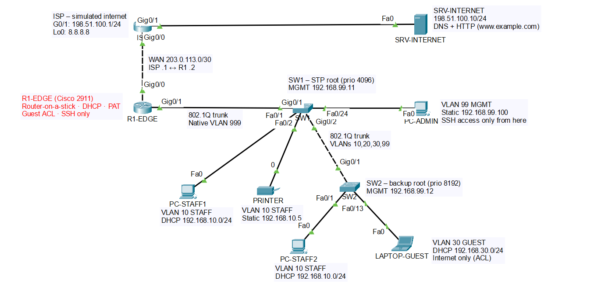
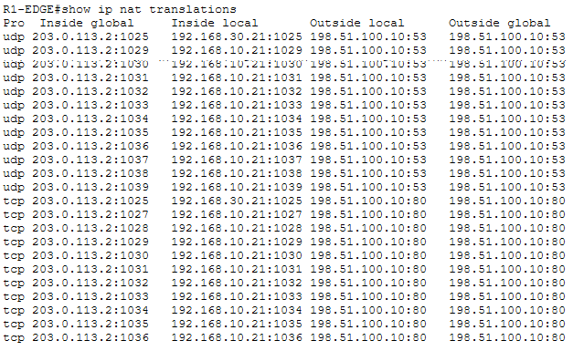
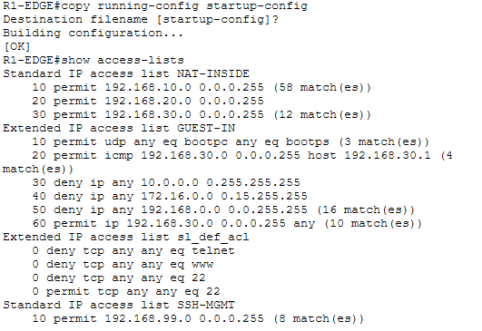

# Small Office / Branch Network – Cisco Packet Tracer

A secure two-floor small-office network, designed, configured and tested in Cisco Packet Tracer.
It covers the core CCNA skills: **VLAN segmentation, trunking, inter-VLAN routing, DHCP, PAT,
ACL-based guest isolation, Layer 2 security and SSH-only management.**

Click the diagram to view it full size.

## Scenario

A small company with two floors needs a network where:

- **Staff** have internal access, IP phones and internet
- **Guests** get internet only, with no access to anything internal
- **IT** can manage every network device securely and remotely
- **Network devices** cannot reach the internet themselves

## Features

| Area | What is implemented |
|---|---|
| **Segmentation** | VLANs 10 STAFF, 20 VOICE, 30 GUEST, 99 MGMT, 666 BLACKHOLE, 999 NATIVE · VTP transparent |
| **Trunking** | 802.1Q, native VLAN 999, allowed-VLAN list, DTP disabled (`nonegotiate`) |
| **Routing** | Router-on-a-stick (subinterfaces) · static default route to the ISP |
| **Services** | DHCP server on the router (per-VLAN pools, exclusions, option 150 for phones) · DNS/HTTP server on the "internet" |
| **Internet access** | PAT (NAT overload) – all users share one public IP |
| **Guest isolation** | Extended ACL – guests reach the internet only, all private (RFC 1918) ranges blocked |
| **Layer 2 security** | Port security (sticky MAC), BPDU Guard, PortFast, unused ports shut down in a blackhole VLAN |
| **Spanning Tree** | Rapid PVST+ with a planned root bridge (SW1 primary, SW2 backup) |
| **Management** | Dedicated MGMT VLAN · SSH v2 only · VTY access limited by ACL · login brute-force protection · password policy |

## Devices

| Device | Model | Role |
|---|---|---|
| R1-EDGE | Cisco 2911 | Office gateway – inter-VLAN routing, DHCP, NAT, ACLs |
| SW1 | Cisco 2960-24TT | Floor 1 switch, STP root bridge |
| SW2 | Cisco 2960-24TT | Floor 2 switch (staff + guest area) |
| ISP | Cisco 2911 | Simulated internet provider |
| SRV-INTERNET | Server-PT | Public DNS + web server (`www.example.com`) |
| PC-STAFF1/2, PRINTER, PC-ADMIN, LAPTOP-GUEST | End devices | Test clients |

## Addressing summary

| VLAN | Name | Subnet | Gateway | Addressing |
|---|---|---|---|---|
| 10 | STAFF | 192.168.10.0/24 | 192.168.10.1 | DHCP (.21 and up) |
| 20 | VOICE | 192.168.20.0/24 | 192.168.20.1 | DHCP (.21 and up) |
| 30 | GUEST | 192.168.30.0/24 | 192.168.30.1 | DHCP (.21 and up) |
| 99 | MGMT | 192.168.99.0/24 | 192.168.99.1 | Static |
| – | WAN | 203.0.113.0/30 | 203.0.113.1 (ISP) | Static |

➡️ Full IP plan, switch port map and cabling: [docs/ip-addressing-plan.md](docs/ip-addressing-plan.md)

## Design decisions

| Decision | Why |
|---|---|
| **Router-on-a-stick** | One trunk link routes all VLANs – right-sized and cost-effective for a small office |
| **VTP transparent** | Prevents a switch with a higher revision number from overwriting or deleting the VLANs |
| **Native VLAN 999 (no users)** | Takes VLAN 1 off the trunks and blocks VLAN-hopping (double-tagging) attacks |
| **Blackhole VLAN 666** | Unused ports are shut down *and* placed in a VLAN that isn't allowed on any trunk |
| **MGMT excluded from NAT** | Network devices have no reason to reach the internet |
| **Guest ACL inbound on G0/1.30** | Extended ACLs go as close to the source as possible, so unwanted traffic is dropped immediately |
| **Different port-security modes** | `restrict` on staff ports (log, keep the port up) · `shutdown` on guest and admin ports (strict) |

## Verification

| Test | Result |
|---|---|
| Staff PC gets an IP via DHCP and reaches its gateway, the other floor and the printer | ✅ |
| Staff and guest browse `www.example.com` (DNS + HTTP through PAT) | ✅ |
| Guest pings a staff PC, a switch or the staff gateway | ✅ Blocked by ACL (16 deny matches) |
| PC-ADMIN connects via SSH to R1-EDGE, SW1 and SW2 | ✅ |
| Staff PC tries SSH to a network device | ✅ Connection refused |
| PC-ADMIN tries to reach the internet | ✅ By design – MGMT is not translated |

**PAT in action:** staff (192.168.10.21) and guest (192.168.30.21) share the public IP 203.0.113.2.
UDP 53 = DNS lookups, TCP 80 = web traffic.

**Guest isolation:** match counters on the ACL after testing.

## Troubleshooting highlights

Real problems found and fixed during the build:

<b>1. Native VLAN mismatch while configuring trunks</b>

- **Symptom:** `%CDP-4-NATIVE_VLAN_MISMATCH` and Spanning Tree blocked the trunk port.
- **Cause:** SW1 was already on native VLAN 999 while SW2 was still on VLAN 1.
- **Fix:** set native VLAN 999 on SW2 → `%SPANTREE-2-UNBLOCK_CONSIST_PORT ... Port consistency restored`.
- **Lesson:** both ends of a trunk must agree on the native VLAN.

<b>2. A port stayed in VLAN 1 after an interface range command</b>

- **Symptom:** `show vlan brief` still listed SW2 Gi0/2 under VLAN 1.
- **Cause:** the combined `interface range` command was only partly applied.
- **Fix:** configured Gi0/2 on its own.
- **Lesson:** IOS applies what it understands and skips the rest – always verify with `show` commands.

<b>3. No internet – configuration pasted into the wrong router</b>

- **Symptom:** `ping 8.8.8.8` failed; `show ip route` on R1 had no default route and no WAN network.
- **Cause:** the WAN, NAT and routing commands had been entered on the ISP router. R1's WAN interface was never configured, so the next hop was unreachable and the static default route was not installed (recursive lookup).
- **Fix:** reset the ISP, reapplied the correct configs on both routers.
- **Lesson:** check the prompt before pasting configuration.

<b>4. DNS and web failing – IP typo on the server</b>

- **Symptom:** `nslookup` timed out and the web page did not load.
- **Diagnosis:** tested hop by hop; the first failure was ISP → server. The ISP interfaces were up/up, and `ipconfig` on the server showed **192**.51.100.10 instead of **198**.51.100.10.
- **Extra catch:** the first correction did not apply – Packet Tracer only saves the field when focus leaves it.
- **Fix:** corrected the IP and verified with `ipconfig`.
- **Lesson:** test one hop at a time, and verify that a change actually took effect.

## How to reproduce

1. Open `packet-tracer/small-office-network.pkt` in Cisco Packet Tracer 9.0.0.
2. Build the topology from the [cabling table](docs/ip-addressing-plan.md) and paste the files from `configs/` into each device.
3. Set PC-STAFF1, PC-STAFF2 and LAPTOP-GUEST to DHCP; give PRINTER and PC-ADMIN their static IPs.
4. On SRV-INTERNET, turn on DNS (A record `www.example.com` → `198.51.100.10`) and HTTP.
5. Run the tests in the [Verification](docs/verification.md) section.
6. > **Lab credentials (Packet Tracer file only):** username `admin` · password / enable secret `Lab2026`. These exist only in this simulation and are never used on real equipment. Secrets are redacted in `configs/` as good practice for public repositories.

## Future improvements

- [ ] DHCP snooping and Dynamic ARP Inspection
- [ ] Redundant uplinks with EtherChannel and HSRP
- [ ] Syslog, NTP and SNMP monitoring
- [ ] IPv6 dual-stack
- [ ] Stateful firewall instead of stateless ACLs
